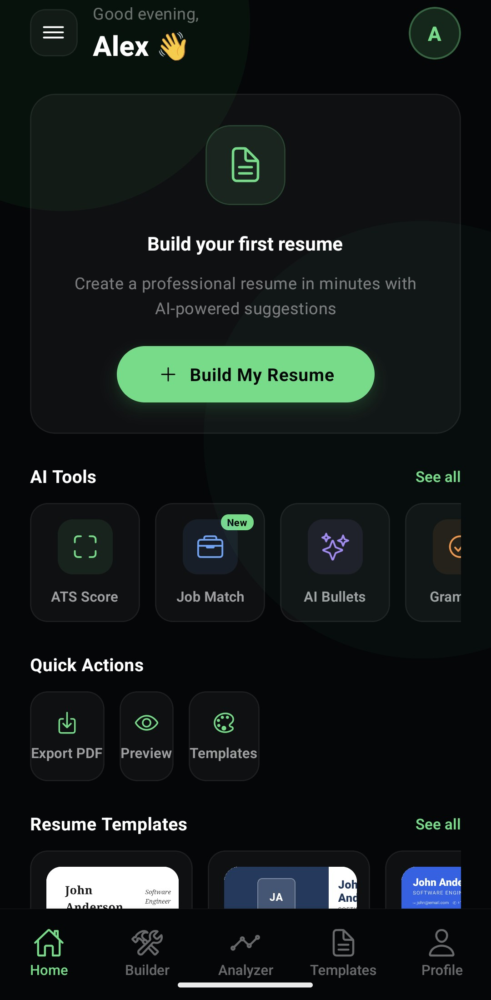
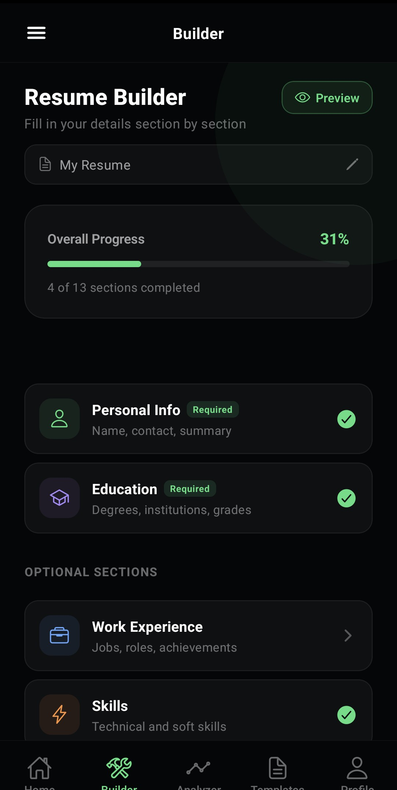
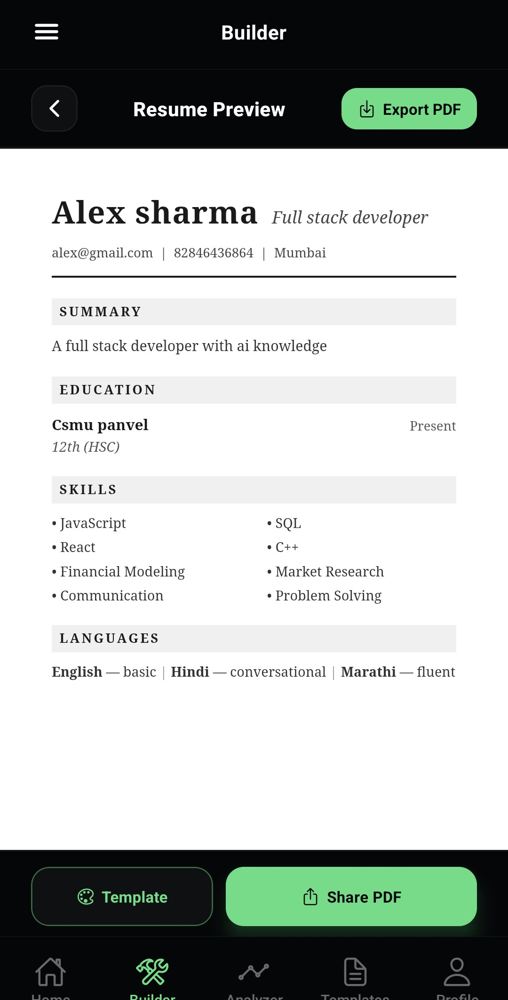
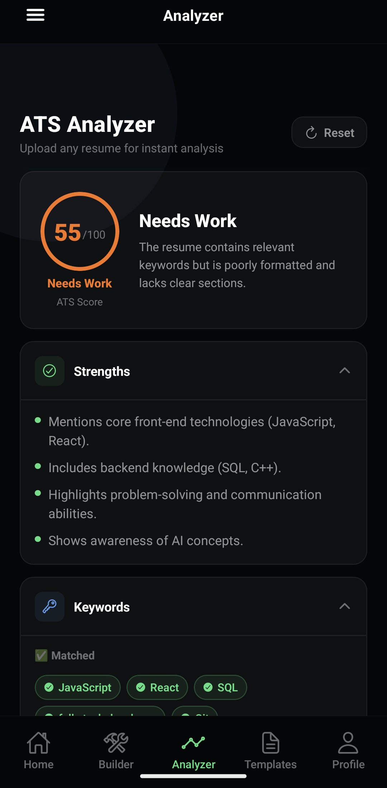

# CVPilot

**Build smarter resumes with AI.**


CVPilot is a mobile app that helps students build professional, ATS-friendly resumes and get instant AI feedback on them. Build a resume section by section, preview it live, export it as a PDF, or upload any existing resume to get an ATS score with actionable suggestions.

**Backend API:** [cvpilot-backend](https://github.com/ErrorInshanu/cvpilot-backend)

---

## Screenshots

| Home | Builder |
|:---:|:---:|
|  |  |

| Resume Preview | ATS Analyzer |
|:---:|:---:|
|  |  |

---

## Features

- **Resume Builder:** 13 guided sections, including personal info, education, experience, skills, projects, certifications, achievements, languages, training and interests, with a live progress tracker.
- **Multiple templates:** switch templates instantly and customize colour, font and size.
- **PDF export and sharing:** generate a PDF on-device and share it from the preview screen.
- **AI ATS Analyzer:** upload any resume PDF and get an ATS score, matched and missing keywords, grammar suggestions, section-by-section feedback, and what to improve or remove. Optionally paste a job description for better keyword matching.
- **Authentication:** email/password signup and login, plus Google Sign-In, with JWT sessions that persist across app restarts.
- **Cloud sync:** resumes are saved to the backend, so you can load and edit them again later.

---

## Tech Stack

| Layer | Technology |
|---|---|
| Mobile app | React Native, Expo, Expo Router |
| State management | Zustand |
| PDF | expo-print, expo-sharing, react-native-webview |
| Auth storage | expo-secure-store |
| Backend | Node.js, Express |
| Database | MongoDB Atlas (Mongoose) |
| Auth | JWT, bcryptjs, Google OAuth |
| AI | Groq API (LLM) |
| Hosting | Render |

---

## How It Works

```
Mobile App (Expo)  ──►  Express API (Render)  ──►  MongoDB Atlas
                                │
                                └──►  Groq LLM (resume analysis)
```

1. The user builds a resume in the app. State lives in a Zustand store and is synced to the backend after each save.
2. The selected template turns the resume data into HTML, which is shown in a WebView and converted to a PDF with `expo-print`.
3. For analysis, the app sends a PDF to the protected `/api/analyze` endpoint. The backend extracts the text, sends it to the Groq LLM, safely parses the JSON response and returns the result.

---

## Engineering Highlights

- **JWT-protected API:** all resume and analyzer routes require a valid token, and every resume route checks that the resume belongs to the logged-in user.
- **Store-to-backend sync:** a central Zustand store with a dedicated sync service handles saving, loading and deleting resumes.
- **HTML-to-PDF pipeline:** templates are pure HTML builders, so the same output powers both the in-app preview and the exported PDF.
- **Resilient AI analysis:** PDF text extraction and cleanup, retry logic, and safe JSON parsing so malformed model output does not crash the server.
- **Secure session handling:** tokens are stored with `expo-secure-store`, not plain storage.

---

## Getting Started

### Prerequisites

- Node.js 18 or later
- Expo Go, or an Android/iOS emulator
- The [backend](https://github.com/ErrorInshanu/cvpilot-backend) running locally or deployed

### Installation

```bash
git clone https://github.com/ErrorInshanu/CVPilot.git
cd CVPilot
npm install
```

### Configure the API

Open `constants/api.js` and set `API_BASE_URL` to your backend URL:

```js
export const API_BASE_URL = "https://your-backend-url";
```

The backend needs its own environment variables. See the backend README for details.

### Run

```bash
npx expo start
```

Then press `a` for Android, `i` for iOS, or scan the QR code with Expo Go.

---

## Project Structure

```
CVPilot/
├── app/            # Screens and routing (Expo Router)
│   ├── (auth)/     # Sign in / Sign up
│   └── (drawer)/   # Drawer + tabs: Home, Builder, Analyzer, Templates, Profile
├── components/     # Shared UI components
├── constants/      # Theme, API endpoints, resume templates
├── context/        # Auth context
├── hooks/          # Custom hooks
├── services/       # API calls, storage, resume sync
├── store/          # Zustand resume store
└── screenshots/    # README images
```

---

## Roadmap

- [ ] Additional modern and creative templates
- [ ] Settings screen
- [ ] Render all optional sections (volunteer, extracurricular, publications) in every template
- [ ] Public release

---

## Author

**Shanu Singh**

- GitHub: [@ErrorInshanu](https://github.com/ErrorInshanu)
- LinkedIn: [shanu-singh](https://www.linkedin.com/in/shanu-singh-6a42ba247/)

If you like this project, consider giving it a star.